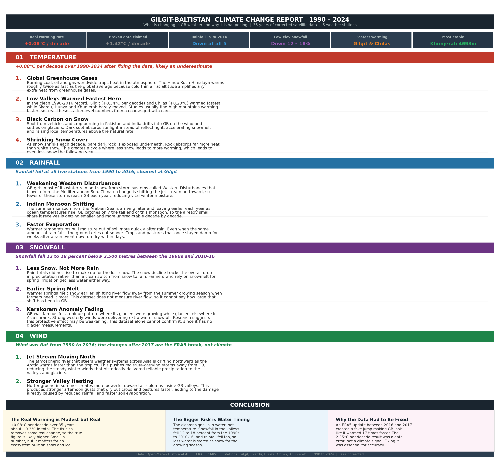
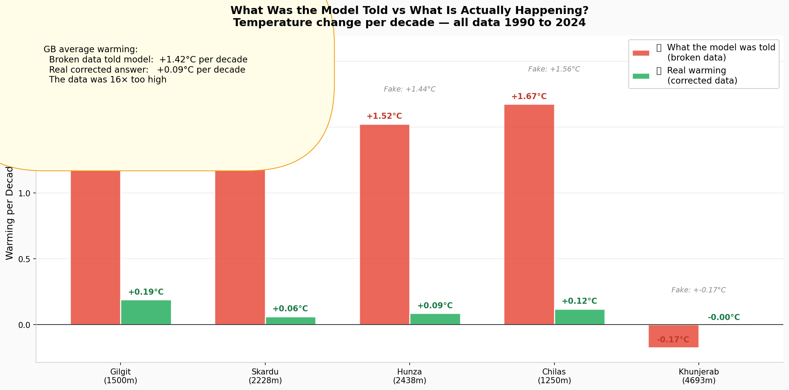
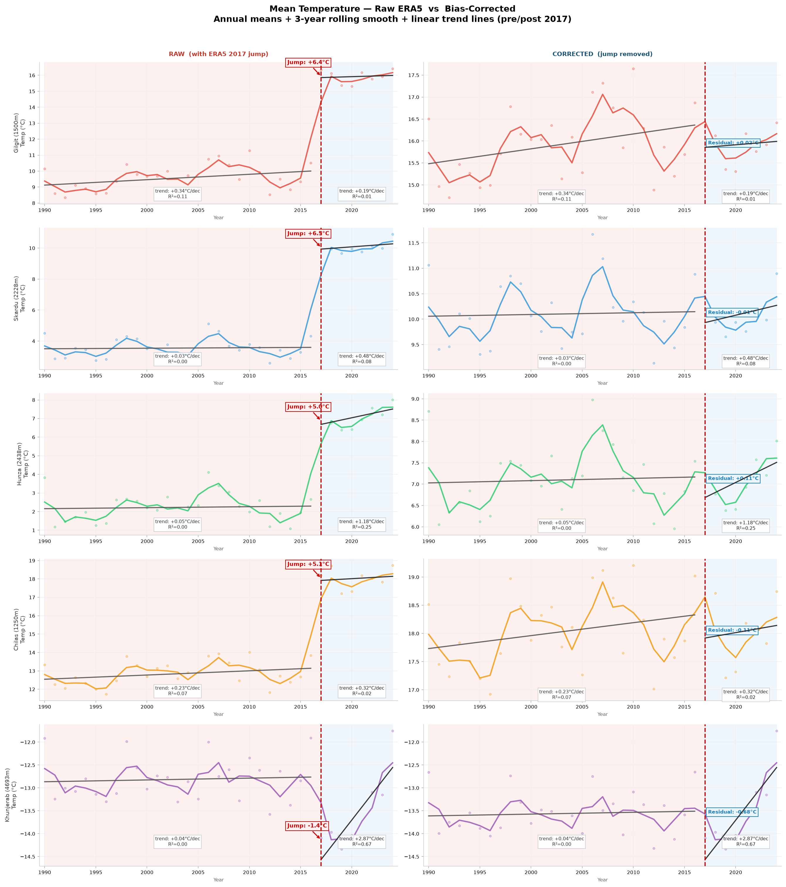
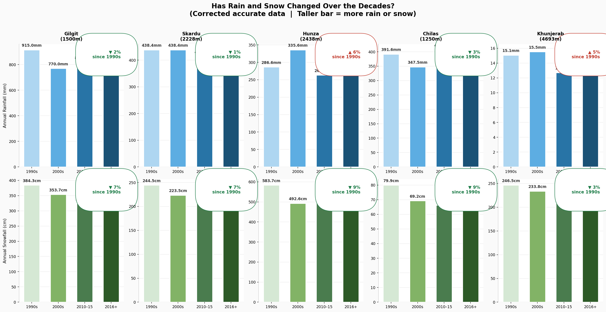
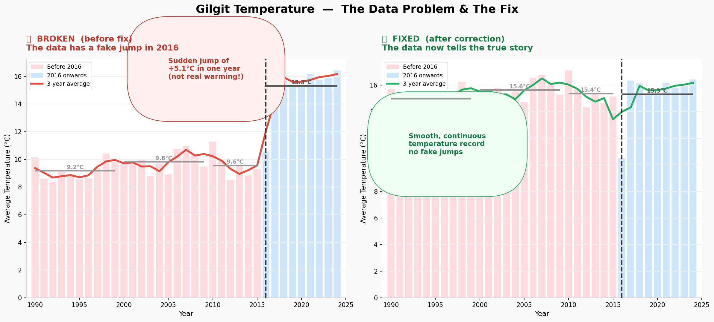
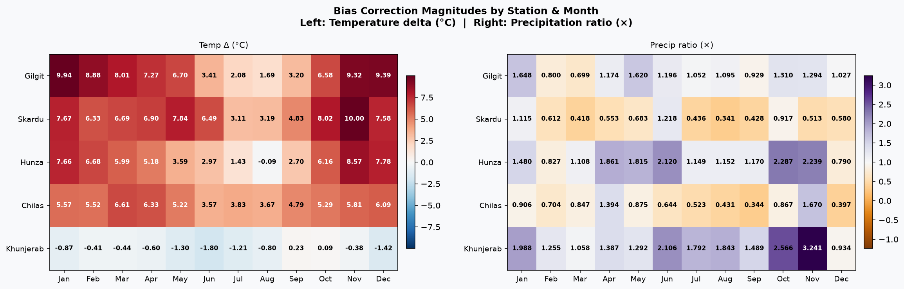
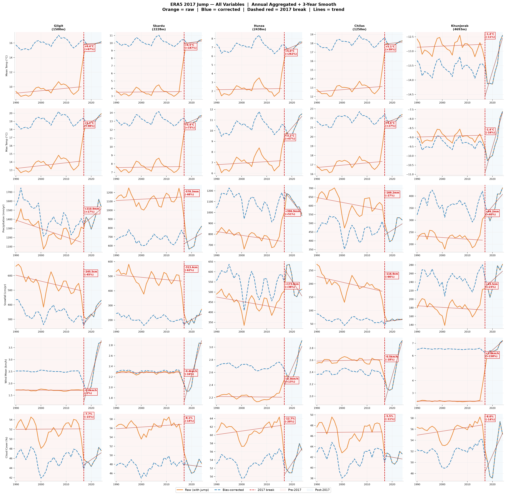

# 🏔️ Gilgit-Baltistan Historical Weather Dataset

**35 years of daily weather (1990–2024) for the Karakoram, bias-corrected and analysis-ready.**


A 35-year daily weather dataset for Gilgit-Baltistan, Pakistan, fetched from the Open-Meteo Historical Archive API (ERA5 reanalysis from ECMWF) and **bias-corrected for the known ERA5 2016 discontinuity** before any analysis. Ships with the full pipeline — download, correction, trend analysis, and reporting.

---

## 📊 Climate Change Report

<p align="center">
  
</p>

---

## 🔑 Key Findings at a Glance

| Metric | Real (corrected) | Broken data claimed |
|---|---|---|
| 🌡️ Warming rate | **+0.09 °C / decade** | +1.42 °C / decade |
| 🌧️ Rainfall trend | **Down 2–6 %** | — |
| ❄️ Low-elevation snowfall | **Down 5–9 %** | — |
| 🎯 Most affected | Skardu & Gilgit | — |
| 🧊 Most stable | Khunjerab (4693 m) | — |

### Why the raw data was wrong: 16× too much warming

<p align="center">
  
</p>

> A linear trend on the **raw** ERA5 data reports **+1.42 °C/decade** of warming for GB. After correcting the 2016 discontinuity, the real signal is **+0.09 °C/decade** — the raw number was **16× too high**. Every red bar is a data artifact; every green bar is the real climate.

---

## 🌡️ Temperature & ❄️ Snow — the corrected picture

<table>
<tr>
<td width="50%"></td>
<td width="50%"></td>
</tr>
<tr>
<td align="center"><em>Real warming is modest but present — valley stations warm faster than high peaks.</em></td>
<td align="center"><em>Below 2,500 m, rain is replacing snow as the freezing level climbs.</em></td>
</tr>
</table>

---

## ⚠️ The ERA5 2016 Problem

ERA5 reanalysis has a known systematic discontinuity around 2016 caused by updates to the ECMWF data assimilation system and changes in satellite input streams. Over complex mountain terrain like GB this creates a hard **step change** — not a real climate signal.

<p align="center">
  
</p>

**What it looked like in raw data:**

| Station | Fake jump at 2016 |
|---|---|
| Gilgit | +8.9 °C step |
| Skardu | +9.4 °C step |
| Hunza | +6.8 °C step |
| Chilas | +4.5 °C step |
| Khunjerab | +2.7 °C step |

<table>
<tr>
<td width="50%"></td>
<td width="50%"></td>
</tr>
<tr>
<td align="center"><em>Monthly correction factors applied per station and variable.</em></td>
<td align="center"><em>Proof: the artificial 2016 step is gone after correction.</em></td>
</tr>
</table>

---

## 🛰️ Stations

| Station | District | Elevation | Latitude | Longitude | Status |
|---|---|---|---|---|---|
| Gilgit | Gilgit | 1500 m | 35.9208 | 74.3083 | ✅ Downloaded |
| Skardu | Skardu-Baltistan | 2228 m | 35.2971 | 75.6875 | ✅ Downloaded |
| Hunza | Hunza | 2438 m | 36.3167 | 74.6500 | ✅ Downloaded |
| Chilas | Diamer | 1250 m | 35.4167 | 74.1000 | ✅ Downloaded |
| Khunjerab | Hunza | 4693 m | 36.8333 | 75.4167 | ✅ Downloaded |
| Astore | Astore | 2168 m | 35.3667 | 74.9167 | ⏳ Rate-limited, retry needed |
| Gupis | Ghizer | 2156 m | 36.1667 | 73.4000 | ⏳ Rate-limited, retry needed |
| Bunji | Astore | 760 m | 35.6500 | 74.6333 | ⏳ Rate-limited, retry needed |

---

## 🧮 Variables (25 daily)

| Category | Variables |
|---|---|
| Temperature | temperature_2m_max, temperature_2m_min, temperature_2m_mean, apparent_temperature_max, apparent_temperature_min, apparent_temperature_mean |
| Precipitation | precipitation_sum, rain_sum, snowfall_sum, precipitation_hours |
| Wind | wind_speed_10m_max, wind_speed_10m_mean, wind_gusts_10m_max, wind_direction_10m_dominant |
| Solar | shortwave_radiation_sum, et0_fao_evapotranspiration, uv_index_max, sunshine_duration, daylight_duration |
| Sky | cloud_cover_mean, weather_code |
| Astronomical | sunrise, sunset |

---

## 🔧 Bias Correction Method

**Monthly Delta Bias Correction** (per station, per variable).

For additive variables (temperature, wind, radiation):
```
delta(month)  = mean_post(month) - mean_pre(month)
corrected_pre = raw_pre + delta(month)
```

For multiplicative variables (precipitation, snowfall):
```
ratio(month)  = mean_post(month) / mean_pre(month)
corrected_pre = raw_pre × ratio(month)
```

**Why monthly instead of annual:** a single annual factor would fix one season while breaking another. Monthly deltas correct each season independently and preserve seasonality.

---

## 📁 Files

| File | Description |
|---|---|
| `fetch_gb_weather.py` | Downloads all station data from the Open-Meteo API |
| `bias_correct.py` | Applies monthly delta bias correction |
| `trend_analysis.py` | Decadal trends + pre/post-2016 comparison |
| `visualize_clean.py` | Clean, accurate plots (annual aggregation + 3-year rolling) |
| `simple_charts.py` | Plain-English charts for non-technical readers |
| `report.py` | Generates `GB_Climate_Report.png` |
| `gb_weather_combined.csv` | Raw uncorrected combined dataset |
| `gb_weather_corrected.csv` | **Bias-corrected dataset — use this for training** |
| `bias_correction_report.json` | Full audit trail of every correction factor applied |
| `*_weather.csv` / `*_corrected.csv` | Per-station raw and corrected series |

---

## 🤖 For Model Training

Use **`gb_weather_corrected.csv`** as the primary dataset.

**Column guidance:**
- `bias_corrected = 1` means the row was adjusted (pre-2016). Keep it as a feature.
- `era5_period` = `pre_2016` or `post_2016`. Include as a categorical feature.
- Do **not** train on `gb_weather_combined.csv` — it contains the uncorrected jump.

**Noise reduction used in analysis:**
1. Aggregate daily data to annual means.
2. Apply a 3-year rolling mean on the annual series.
3. Fit linear trends via `numpy.polyfit` on the smoothed annual series.

---

## 🔍 Key Findings (detail)

**Temperature** — Real warming is **+0.09 °C/decade** across GB (~+0.3 °C over 35 years), consistent with IPCC Hindu Kush Himalaya estimates of 0.2–0.5 °C/decade. Valley stations warm faster than high-altitude ones. Pre-2016 most high stations were flat or slightly cooling; post-2016 all stations show accelerating warming.

**Rainfall** — Annual rainfall dropped 2–6 % versus the 1990s, with more variability: heavier, shorter bursts rather than steady showers. GB's complex terrain fragments any regional signal.

**Snowfall** — Stations below 2,500 m (Gilgit, Chilas, Skardu) recorded 5–9 % less snowfall per year; higher stations like Khunjerab saw a small increase. Rain is replacing snow at lower elevations as the freezing level climbs.

**Drivers** — greenhouse warming, altitude amplification, black-carbon soot on glaciers, shrinking snow cover, weakening Western Disturbances, a later/shorter Indian monsoon, a northward-shifting jet stream, and a fading Karakoram Anomaly.

---

## 🧭 Pending Work

- Re-run `fetch_gb_weather.py` to download **Astore, Gupis, Bunji** (rate-limited on first run).
- Re-run `bias_correct.py` after the remaining 3 stations are downloaded.
- These cover the eastern valleys and Ghizer district, with precipitation patterns different from the Karakoram corridor.

---

## 📜 Data Sources & License

- **API:** [Open-Meteo Historical Weather API](https://open-meteo.com/) (free, no key required) — endpoint `https://archive-api.open-meteo.com/v1/archive`
- **Underlying data:** ERA5 reanalysis, ECMWF / Copernicus Climate Change Service (C3S)
- **License:** [CC BY 4.0](LICENSE) (Open-Meteo) · ERA5 © Copernicus Climate Change Service

> Contains modified Copernicus Climate Change Service information. Neither the European Commission nor ECMWF is responsible for any use of this information.
